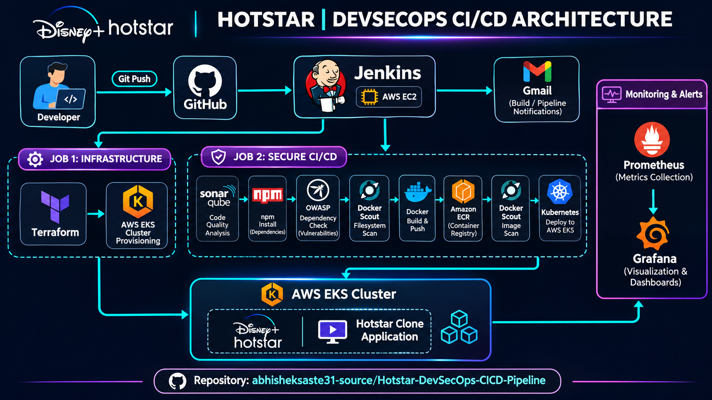

<div align="center">

# 🎬 Hotstar DevSecOps CI/CD Pipeline

### Secure, automated application delivery on AWS EKS

   

**[📂 Repository](https://github.com/abhisheksaste31-source/Hotstar-DevSecOps-CICD-Pipeline)** · **[💼 LinkedIn](https://www.linkedin.com/in/abhisheksaste)**

</div>

---

## 📌 Project Overview

This project demonstrates an end-to-end **DevSecOps CI/CD workflow** for a Hotstar-inspired web application. It combines source control, Jenkins automation, code-quality and dependency checks, container security, Docker image delivery, and Kubernetes deployment on **Amazon EKS**. The supplied architecture also includes monitoring with Prometheus and Grafana and email notifications.

> **Note:** This is a portfolio/learning project, not an official Disney+ Hotstar deployment. The diagram describes the intended architecture; configure the integrations and credentials for your own environment.

## 🏗️ Architecture Diagram



[🔍 View full-size architecture](architucture/Hotstar_Architecture.png)

## 🛠️ Technology Stack

| Area | Tools / Services |
|---|---|
| Version control | Git, GitHub |
| CI/CD orchestration | Jenkins |
| Cloud infrastructure | AWS EC2, Amazon EKS, Amazon ECR |
| Infrastructure as Code | Terraform |
| Code quality | SonarQube |
| Dependency analysis | OWASP Dependency-Check |
| Container security | Docker Scout (architecture reference); Trivy (repository description) |
| Application dependencies | Node.js, npm |
| Containerization | Docker |
| Orchestration | Kubernetes |
| Monitoring | Prometheus, Grafana |
| Notifications | Gmail / email alerts |

## 🔄 CI/CD Workflow

```text
Developer → GitHub → Jenkins (AWS EC2)
                         │
             ┌───────────┴───────────┐
             │                       │
      Infrastructure Job       Application CI/CD Job
             │                       │
          Terraform              Checkout source
             │                       │
       Provision AWS EKS         Install npm packages
                                     │
                                SonarQube analysis
                                     │
                              OWASP dependency scan
                                     │
                             Container security scans
                                     │
                              Docker build & push
                                     │
                                  Amazon ECR
                                     │
                              Deploy to AWS EKS
                                     │
                           Prometheus + Grafana
                                     │
                              Email notifications
```

## 📁 Repository Structure

```text
Hotstar-DevSecOps-CICD-Pipeline/
├── EKS_TERRAFORM/          # Terraform configuration for EKS
├── K8S/                   # Kubernetes deployment resources
├── public/                # Public application assets
├── src/                   # Application source code
├── Dockerfile             # Container image definition
├── package.json           # Node.js scripts and dependencies
├── package-lock.json      # Locked npm dependencies
├── architucture/          # Architecture images (add if not present)
│   └── Hotstar_Architecture.png
└── README.md
```

## 🚀 Getting Started

### Prerequisites

- Git, Node.js and npm
- Docker
- AWS account and AWS CLI with appropriate permissions
- Terraform and kubectl
- Jenkins with required plugins and credentials
- SonarQube, OWASP Dependency-Check, and selected container scanner configured for the pipeline

### 1. Clone the repository

```bash
git clone https://github.com/abhisheksaste31-source/Hotstar-DevSecOps-CICD-Pipeline.git
cd Hotstar-DevSecOps-CICD-Pipeline
```

### 2. Install application dependencies

```bash
npm ci
```

### 3. Build a Docker image

```bash
docker build -t hotstar-devsecops:latest .
```

### 4. Review the infrastructure configuration

```bash
cd EKS_TERRAFORM
terraform init
terraform validate
terraform plan
```

> Review the plan, IAM permissions, AWS region, and expected cloud charges before running `terraform apply`. Provisioning and deployment are not automatic just from cloning this repository.

### 5. Configure the Jenkins pipeline

Connect Jenkins to this GitHub repository, configure the scanner integrations and credentials, and set up the image registry and EKS access. Use your actual pipeline definition and Kubernetes manifests in `K8S/` to deploy the application.

**Security:** Store tokens, passwords, and registry credentials in Jenkins Credentials or another secrets manager. Never commit secrets to GitHub.

## 🔐 Security Practices

- **SonarQube:** Analyze code quality and maintainability.
- **OWASP Dependency-Check:** Identify known vulnerabilities in application dependencies.
- **Docker Scout / Trivy:** Scan container filesystems and images, depending on the configured pipeline.
- **Jenkins:** Automate checks before image publishing and deployment.
- **Kubernetes:** Run the containerized application on EKS.

## 📊 Monitoring and Alerts

The architecture includes **Prometheus** for metrics collection, **Grafana** for dashboards, and **email notifications** for pipeline events. These services require their own installation and configuration.

## 🎯 Learning Outcomes

- Build an end-to-end Jenkins-based CI/CD workflow
- Integrate code analysis and vulnerability scanning
- Package and publish applications as Docker images
- Provision and deploy workloads to AWS EKS
- Understand monitoring and alerting in a cloud-native environment

## 👨‍💻 Author

**Abhishek Saste**

- 💼 LinkedIn: [linkedin.com/in/abhisheksaste](https://www.linkedin.com/in/abhisheksaste)
- 🐙 GitHub: [abhisheksaste31-source](https://github.com/abhisheksaste31-source)
- 📦 Project: [Hotstar-DevSecOps-CICD-Pipeline](https://github.com/abhisheksaste31-source/Hotstar-DevSecOps-CICD-Pipeline)

---

<div align="center">

⭐ **If you find this project useful, consider starring the repository!**

</div>
